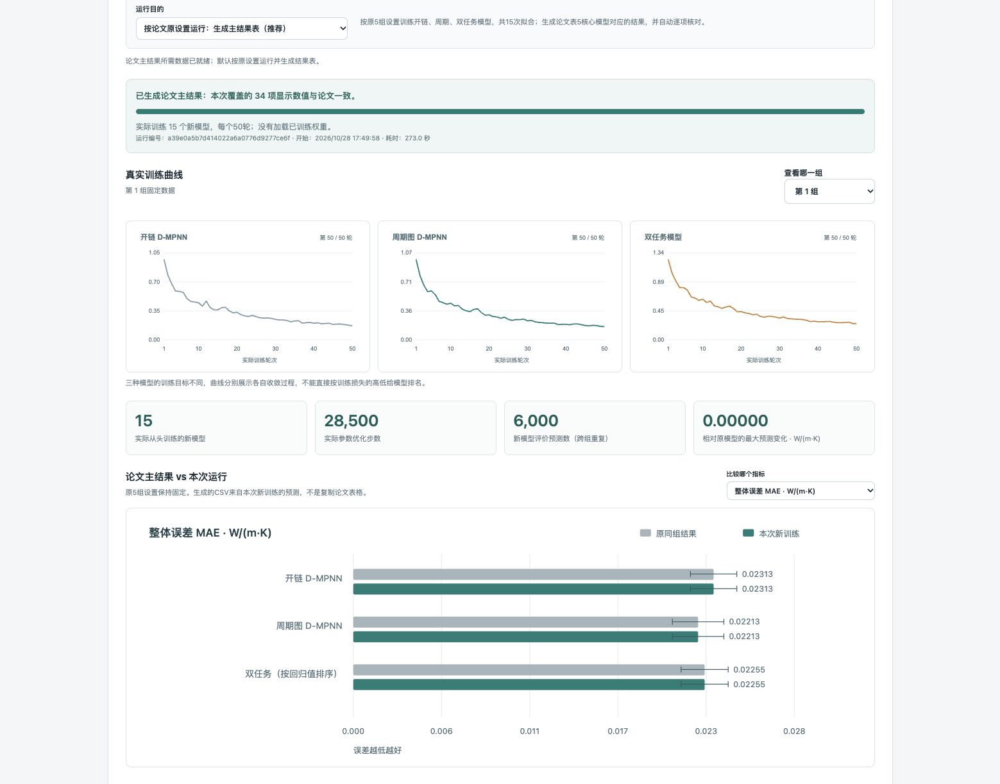

# Polymer D-MPNN thermal-conductivity models and paper reproduction

**中文快速开始在本页下方。** [完整中文教程](README_zh-CN.md) · [复现数据](reproduce/data/) · [训练输入与划分](reproduce/inputs/) · [65份论文模型权重](polymer_dmpnn/paper_weights/) · [示例CSV](examples/polymers.csv)

## 下载后运行论文主结果

下载并解压整个仓库，安装Python 3.10–3.13（建议3.12），在目录中运行：

```bash
python start_ui.py
# macOS通常使用 python3 start_ui.py
```

网页默认 **“按论文原设置运行：生成主结果表”**，点击 **“运行论文主结果”** 即可。
程序固定原数据划分、训练随机设置和参数，实际从头训练15个核心模型，
根据本次新预测生成 **paper_main_results.csv**，核对表5核心模型对应的34个显示数值。
CSV、新权重、逐条预测、训练曲线和日志均可下载。发现差异时如实报告，不用旧表覆盖。

这里是让读者运行并得到论文对应的主结果，不要求重新做数据收集、MD模拟或历史全部探索。
范围为开链/周期/双任务及其分类排序，未覆盖表5其他基线或整篇历史训练。
其他表的保存预测复算仍在“其他核对”中；“新随机起点”只是可选稳定性试跑，不是默认复现模式。

命令行也能直接运行：

```bash
python -m pip install .
python reproduce/train_from_scratch.py --paper-settings --output paper-main-results
```

首次界面启动需联网安装依赖并保持终端运行；后续复用.ui-venv。计算在本机完成，
无须API密钥。输出目录须为新目录。详细操作见[中文教程](docs/USER_GUIDE_zh-CN.md)。

**实际跨平台结果：**Linux Python 3.10/3.11/3.12均完成15组重训；整体MAE与原论文相差不到1%，上述核心均值比较关系保持，但小数并非逐项完全一致。这是已测结果，不是任意环境的通过保证。详见[实际重训结果与解释](docs/REPRODUCIBILITY.md)。



## 第一次使用 从这里开始

下载整个仓库：点击 **Code → Download ZIP** 并解压，或使用下面的 `git clone`。
在解压后的仓库根目录打开终端，需要 Python 3.10 或以上版本；已测试3.10、3.11、3.12。
以下命令中的 `python` 应指向该Python安装（部分macOS使用 `python3`）。

### 先重算论文表1–5 不需要安装机器学习依赖

```bash
git clone https://github.com/diudiu-aa/polymer-dmpnn-thermal-conductivity.git
cd polymer-dmpnn-thermal-conductivity
python reproduce/paper_tables.py --verify --output reproduced-paper-tables
```

如果已下载并解压ZIP，从第三行运行。成功时终端显示：

```text
Recomputed Tables 1–5: 182 displayed statistics from 117 saved prediction groups; verified=True
```

新生成的 `reproduced-paper-tables/` 中包含 `table_1.csv` 至 `table_5.csv`、
对应Markdown表格、逐种子指标和 `verification.json`。输出目录必须是新目录，
重复运行时请换一个名称。**这是从保存预测重新计算指标，不是重新训练。**

### 再用自己的结构预测热导率

```bash
python -m pip install .
python -m polymer_dmpnn --paper-model table5_B600_periodic_32101 --smiles '*CC*'
python -m polymer_dmpnn --paper-model table5_B600_periodic_32101 --batch examples/polymers.csv --format csv --output predictions.csv
```

`table5_B600_periodic_32101` 是论文表5的一个周期模型种子。也可选择
`table5_B600_multitask_32101`；运行 `python -m polymer_dmpnn --list-models` 查看全部标识。
自己的CSV使用 `smiles` 列，可附 `id` 列；格式见 [examples/polymers.csv](examples/polymers.csv)。
成功结果含 `success=true` 和 `predicted_kappa_W_mK`，单位W/(m K)。
合法结构能计算出预测，不代表对所有新材料都准确。

### 数据和权重实际在哪里

| 需要什么 | 已公开文件 | 用途 |
|---|---|---|
| 五张主表的逐条参考值与预测 | [reproduce/data/saved_predictions.csv.gz](reproduce/data/saved_predictions.csv.gz) | 117组、40,848行评价记录，供五表复算；包含跨模型/种子的重复记录 |
| 主要模型训练和评价输入 | [reproduce/inputs/records.csv.gz](reproduce/inputs/records.csv.gz) | 14,112条不同记录，含SMILES、来源UUID、结构簇和热导率 |
| 固定划分及样本顺序 | [reproduce/inputs/splits.json](reproduce/inputs/splits.json) | 表3–5各随机种子的拟合/评价记录ID，训练顺序不可重排 |
| 数据字段与解压方法 | [reproduce/inputs/README.md](reproduce/inputs/README.md) | 数据字典、Python读取示例和来源说明 |
| 模型参数 | [polymer_dmpnn/paper_weights/](polymer_dmpnn/paper_weights/) | 65份图模型checkpoint，模型身份及SHA在manifest中 |
| 数据许可和出处 | [THIRD_PARTY_DATA.md](THIRD_PARTY_DATA.md) | 固定数据源、许可及整理修改说明 |

`.csv.gz` 是压缩CSV，GitHub网页不会像普通文本一样展开。**下载整个仓库时会一起下载**；
复现程序自动读取压缩文件，不需要手工解压。公开内容为复现所需整理子集，并非完整原始数据库。

### 权重重测和固定配方重训

安装模型包后，运行下面命令可重测65份已保存权重，与原保存预测核对：

```bash
python reproduce/evaluate_checkpoints.py --output checkpoint-verification
```

若要真正重新训练，请按 [详细复现教程](reproduce/README.md#train-from-fixed-curated-inputs)
使用显式 `--run` 命令。当前提供表3–5主要模型的固定输入训练；
表1/2提供保存预测的指标复算。完整历史原始清洗、聚类/角色生成以及旧GIN/GPR训练不在此全链复现范围内。

## English documentation

CPU inference, saved-result reproduction of **manuscript Tables 1–5**, and
fixed-input training for the main graph experiments. Targets are simulated
thermal conductivity of nominally unstrained amorphous polymers near **300 K,
1 atm**, in **W/(m K)**. [中文说明](README_zh-CN.md).

## Reproduce all five tables — no model installation needed

```bash
git clone https://github.com/diudiu-aa/polymer-dmpnn-thermal-conductivity.git
cd polymer-dmpnn-thermal-conductivity
python reproduce/paper_tables.py --verify --output reproduced-paper-tables
```

Python 3.10+ and its standard library suffice. The command recalculates 182
means/sample standard deviations from 117 saved prediction groups (40,848
rows), verifies them against the manuscript, and writes five CSV/Markdown
tables, per-seed metrics and `verification.json`. All inputs are included.
No private project directory, account, network, or raw database is needed.
The output directory must be new. Expected statistics verify the calculation;
they are not copied as generated results.

## Train new models from scratch in the browser

The default browser mode uses --paper-settings: original five splits and original
training seeds, from-scratch open/periodic/multitask fitting, and a generated
paper_main_results.csv with 34 covered display-statistic comparisons. New-start
trials remain optional. The optional new-start page trains paired models for 50 epochs,
without loading released checkpoints. A fresh recorded training seed controls
initialization, data order and dropout; the original data splits, targets and
hyperparameters stay fixed. A quick run trains three models on the first fixed
600-fit/400-evaluation split; the full option trains 15 models over the original
five splits. A quick run compares the matching original split-level results,
not the paper's five-repeat mean. Results may improve or worsen; differences
are reported rather than converted into an exact-match PASS.

```bash
python reproduce/train_from_scratch.py --repeats 1 --output new-training
# Replay a recorded training start with the same fixed split(s):
python reproduce/train_from_scratch.py --repeats 1 --training-seed 123456 --output replay-training
```

The browser shows real epoch/loss curves and optimizer steps, then computes
metrics and rankings after fitting. The downloaded ZIP includes new weights,
new predictions, curves, random starts, hashes and logs. One/latest temporary
training run is retained; download before restarting or closing the service.
The 30-minute run is cancellable. Training and checkpoint-retest jobs do not
run concurrently. This is a reproducibility/variation run on existing public
evaluation data, not new independent external validation or full-paper retraining.

## Fresh model retest

The browser tab “重新测试论文模型” runs fresh CPU inference for all 15 Table 5
open/periodic/multitask checkpoints on their fixed 400-record evaluation sets
(6,000 record predictions, not independent materials). Old predictions are
loaded only after the new prediction files and receipt are written. New metrics,
rankings, progress, comparison plots and an artifact ZIP are provided. Prediction
tolerance, manuscript display agreement and candidate-rank agreement are reported
separately. This covers 34 Table 5 displayed statistics, not full-paper retraining.
Each new start creates a new run; active duplicate starts attach to the same job.
Only the latest temporary run is kept; download before restarting or closing.
The 10-minute job can be cancelled.

## Local browser interface

Run `python start_ui.py` from the downloaded repository (use `python3` on macOS if needed).
Python 3.10–3.13 must already be installed; 3.12 is recommended. On first launch the
bootstrap creates `.ui-venv` and installs this package and dependencies using pip.
A local browser page then opens. Keep the terminal running; Ctrl+C stops it.
OS launchers are also included: `start_ui_windows.bat`, `start_ui_macos.command`,
and `start_ui_linux.sh`. If double-clicking is unavailable, use the Python command.

The Chinese-language UI supports single SMILES with 2D depiction, CSV upload or
paste, column selection, all 65 individual models plus the legacy ensemble,
optional reference-label MAE/RMSE/R², CSV/JSON downloads, and verified five-table
replay with an interactive dashboard: model/error-bar comparisons, label-budget
learning curves, five numeric tables, SVG/CSV exports and a full result ZIP. The default is one Table 5 periodic seed, unlike
the backwards-compatible CLI default ensemble. No fitting is started by this UI.
Predictions and replay run locally on loopback; no API key or cloud upload is used.
First installation needs internet and disk space for PyTorch and other packages.

With the package already installed, `python -m polymer_dmpnn.web` (or
`polymer-kappa-ui`) starts the same interface. Run from the complete repository
for table replay, or pass `--repository /path/to/downloaded/repository`.
A package-only install supports inference but does not contain the repository's
`reproduce/` dataset. CSV batches are limited to 1,000 rows and a 2 MB request;
use the CLI for larger jobs. [Detailed Chinese UI guide](docs/USER_GUIDE_zh-CN.md).

## Install and predict

```bash
python -m pip install .
polymer-kappa --smiles '*CC*'
polymer-kappa --batch examples/polymers.csv --format csv --output predictions.csv
```

Use Python 3.10–3.13 on a platform supported by RDKit/PyTorch. Exactly two
single-bonded, degree-one `*` connection points in one connected repeat unit
are required. Quote SMILES in the shell. `--column` changes the CSV structure
column. Invalid entries remain as error rows (exit 2 if any row fails).

The default remains the original three-seed L1000 periodic ensemble (Table 1
model family; 600 fitting records per seed). Its output includes individual
predictions, mean, and population SD. **Ensemble prediction metrics differ
from the paper's mean of separately calculated seed metrics.** The SD is not
a calibrated prediction interval.

Select an actual individual main-study checkpoint explicitly:

```bash
polymer-kappa --list-models
polymer-kappa --paper-model table5_B600_multitask_32101 --smiles '*CC*'
polymer-kappa --paper-model table5_B600_periodic_32101 --batch examples/polymers.csv
```

The 65 individual graph checkpoints cover Tables 3–5: open/periodic/ranking,
nested learning budgets, and the balanced/multitask comparison. They retain
the original bytes, target scaling, seed, and SHA256. Multitask classification
outputs are raw ranking logits, not calibrated probabilities. The regression
model does not guarantee high-conductivity screening or experimental accuracy.

## Verify weights or train from fixed inputs

```bash
# Re-run all 65 saved checkpoints on their fixed 400-record evaluation sets.
python reproduce/evaluate_checkpoints.py --output checkpoint-verification

# Inspect a fixed training configuration; no fitting by default.
python reproduce/train_graph_models.py --experiment table5 --arm multitask --seed 32101

# Explicit 50-epoch CPU reproduction of that single configuration.
python reproduce/train_graph_models.py --experiment table5 --arm multitask --seed 32101 --run --output retrained-multitask
```

The fixed training inputs and roles are bundled. There is no `--project-root`
requirement. For Ridge/ExtraTrees training-only grouped tuning, install
`python -m pip install '.[reproduce]'` and see [reproduce/README.md](reproduce/README.md).

| Reproduction level | Included / verified scope |
|---|---|
| Saved-prediction metrics | All five main tables; 182 displayed mean/SD values |
| Saved graph checkpoint evaluation | All 65 Table 3–5 fits, fixed roles, scales, original predictions |
| Training from fixed curated inputs | Graph recipes for Tables 3–5 and tuned Table 5 Ridge/ExtraTrees; explicit `--run` |
| Entire raw-to-curated historical study | Not claimed: historical cluster/role construction and Table 1 GIN/GPR training are not rebuilt by these commands |

Table 4's 600-fit point reuses Table 3. Table 2 is a retrospective public OPC
cohort; its MAE weights clusters equally, not records. Five-seed samples can
share records and evaluation clusters. A successful saved-result replay is
not an independent replication of the original MD simulations.

## Tests, environment and versioning

```bash
python -m unittest discover -s tests -v
```

CI tests installation, inference, published table reproduction and checkpoint
parity on Python 3.10/3.11/3.12. The original model environment was Python
3.12.14 / PyTorch 2.14.1 / NumPy 2.5.4 / RDKit 2026.03.3, CPU, one thread.
Other supported versions are allowed; RDKit sanitization and numerical
libraries may change outputs. Saved predictions make table reproduction
independent of those differences. Checkpoint parity tolerance is absolute
`1e-5 W/(m K)`; training bit-for-bit parity across library/platform versions
is not promised. Record the Git commit with every reproduced result.

## Sources and licenses

Code and project weights: MIT. Curated PolyOmics excerpts: CC BY 4.0;
OPC source data: MIT. Original UUIDs, fixed snapshot, hashes and modifications
are documented in [THIRD_PARTY_DATA.md](THIRD_PARTY_DATA.md) and manifests.
No PoLyInfo exports, restricted experimental tables, paper PDFs or private
project logs are included. No archival DOI has been assigned to this repo.

- PolyOmics: [DOI 10.57967/hf/7475](https://doi.org/10.57967/hf/7475).
- Yang et al., D-MPNN, *JCIM* 2019: [10.1021/acs.jcim.9b00237](https://doi.org/10.1021/acs.jcim.9b00237).
- Antoniuk et al., periodic polymer graphs, *JCIM* 2022: [10.1021/acs.jcim.2c00875](https://doi.org/10.1021/acs.jcim.2c00875).

This repository evaluates existing representation/learning ideas on the
thermal-conductivity task; it does not claim to invent periodic polymer graphs.

### Local release validation

In the recorded original CPU environment, all 65 checkpoint evaluations
(26,000 predictions) matched the original saved values exactly. Representative
unchanged-recipe retraining also matched for a 60-label periodic graph model,
the 600-label multitask model, and tuned Ridge (seed 32101). These checks are
recorded in [release_validation.json](reproduce/release_validation.json);
they do not claim that every configuration was retrained on every platform.


## Additional controlled-model experiments (3,000 fitting labels)

The original default predictor and Tables 1–5 are unchanged. New material is separate:

```bash
# Recompute the added graph/kernel/budget results (no ML dependencies needed)
python reproduce/optimization/replay.py --output reproduced-optimization
# Optional exact conditional-interval replay (NumPy required)
python reproduce/optimization/replay.py --intervals --output reproduced-optimization
# Use an explicitly named larger-budget model
python -m polymer_dmpnn.optimization --arm periodic --seed 32101 --smiles '*CC*'
# Run all ten models on the cross-publication APFE cohort and recompute metrics
python reproduce/apfe/replay.py --download-reference --run-models --intervals --output apfe-fresh-inference
```

Install the project first (`python -m pip install .`) for model commands. The added [English replay guide](reproduce/optimization/README_English.md), [中文复算说明](reproduce/optimization/README.md) and [APFE guide](reproduce/apfe/README.md) distinguish saved-result replay, new inference and retraining. Batch prediction: `python -m polymer_dmpnn.optimization --input examples/polymers.csv --output predictions.csv`.

The added package covers 70 groups/1,050 per-seed metric checks and 48 conditional intervals; ten additional frozen weights are provided. Internal MAE reached 0.01868 at 3,000 labels and 50 epochs, with label and optimization effects controlled separately. Transfer to 93 retained APFE candidates was substantially poorer (periodic MAE 0.09482, R² 0.0418); overall periodic superiority was not established there. These are amorphous-polymer MD predictions, not validated experimental conductivity values.
